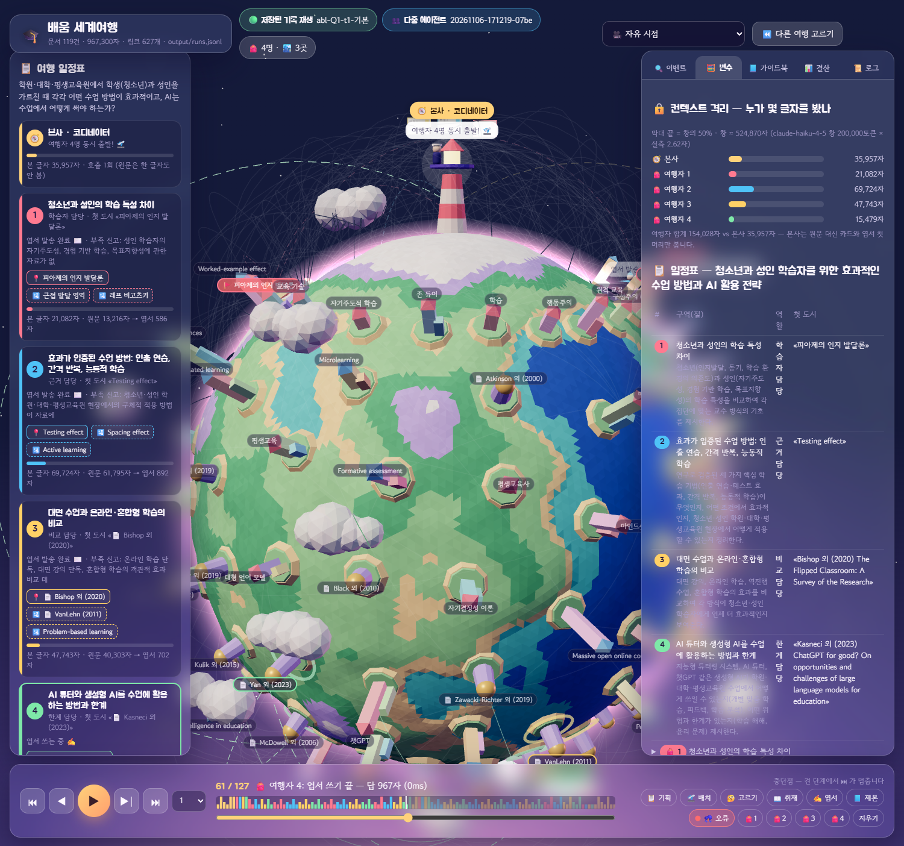
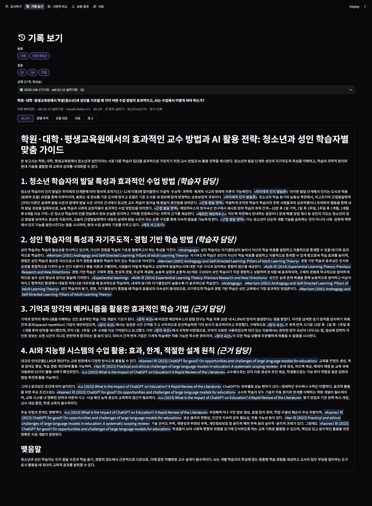
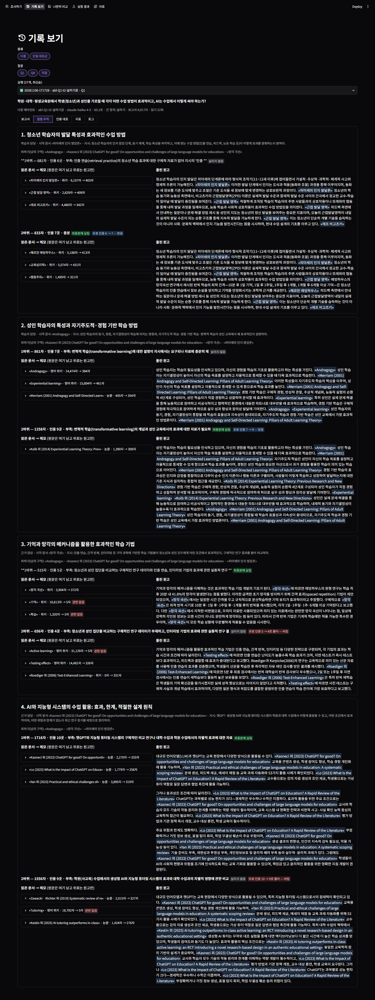

# 🎓 교육법 딥리서처 (learning-deep-researcher)

**"학원·대학·평생교육원에서 학생(청소년)과 성인을 어떻게 가르쳐야 하고, AI는 수업에 어떻게 써야 하나?"**
같은 질문을, 코디네이터 1명이 목차를 짜고 리서처 4명이 자기 구역의 자료만 나눠 읽어 인용 붙은 장문 보고서로 답합니다.
모두의연구소 「에이전트 팀 꾸리기」 딥리서처 프로젝트 제출물입니다. 설계와 실험 결과는 [REPORT.md](REPORT.md)에 있습니다.

```
질문 → ① 기획 → ② 배치 ═╦═ ③ 리서처 ×N (동시) ═╦═ ④ 점검 ─→ ⑤ 종합 → ⑥ 평가
        (카드만 보고     ║  읽기·고르기·쓰기·    ║   부족 신고한 절만
         목차·역할·배정)  ╚══ 자기 신고 ═══════════╝   ↺ ② 로 (최대 2바퀴)
```

## 빠른 시작

```powershell
uv venv --python 3.12 .venv            # 또는 python -m venv .venv
uv pip install --python .venv\Scripts\python.exe -r requirements.txt
copy .env.example .env                 # ANTHROPIC_API_KEY=sk-ant-... 채우기 (저장소에 올라가지 않음)

.venv\Scripts\python -m streamlit run app.py        # 데모 화면 http://localhost:8501
.venv\Scripts\python graph.py --q Q4                # 터미널에서 한 번 (질문 세트 Q4)
.venv\Scripts\python graph.py --q Q4 --off 재위임   # 장치 하나 끄고
.venv\Scripts\python baseline.py --q Q4 --budget 15 # 단일 에이전트 대조군 (같은 읽기 예산)
.venv\Scripts\python ablation.py                    # 스위치 실험 → output/ablation.json
```

키가 없어도 `app.py`의 **기록 보기 · 나란히 비교 · 실험 결과 · 자료** 페이지는 저장된 실행(`output/runs.jsonl`)으로 볼 수 있습니다.
모델은 `config.json`의 `"모델"`(기본 `claude-haiku-4-5`, 창 200K)입니다. 실행 1회 ≈ 1분 · 30~50회 호출 · 약 $0.15.

## 파일

```
data/          corpus.json (문서 119건 + 링크 627개 + 출처 meta) · questions.json (질문 10건과 "왜 나눌 만한가")
               token_count.json (실측 토큰: 368,586 = 창의 1.84배) · papers_raw.json (OpenAlex 원본 캐시)
config.json    도메인에 묶인 값: 모델·절수·절예산·최대바퀴·카드 길이·역할 명단·목차 지침·스위치
graph.py       LangGraph: 기획 → 배치 → 리서처(Send) → 점검(↺ 재위임) → 종합 → 평가
metrics.py     정답표·판정 모델 없는 지표 — 경보 3종(0이어야 함) + 신호 7종, 지표마다 볼 장치
baseline.py    단일 에이전트 대조군 — 같은 모델·자료·도구·카드·읽기 예산, 예산을 끝까지 쓰게 강제
ablation.py    스위치 5종을 하나씩 끄고 + 대조군, 질문×시행 반복, 스위치가 코드 경로를 실제로 바꿨는지 확인
app.py         Streamlit 데모 (app_pages/ 다섯 페이지, ui.py 공용 화면 조각)
tools/         자료 수집: collect_corpus.py(위키) → add_papers.py(논문) → count_tokens.py(토큰 실측)
               export_sim.py: runs.jsonl → 시뮬레이터 이벤트 (static/sim/data/, 페이지를 열면 자동으로 다시 만듦)
static/sim/    3D 여행 시뮬레이터 (Three.js 한 파일) — Streamlit 정적 서빙(/app/static/sim/)으로 열림
output/        runs.jsonl (실행 전부: 목차·절별 원고·읽은 문서·메모·결정·지표) · ablation.json · reports/*.md
REPORT.md      제출 보고서
```

## 데모 화면

| 페이지 | 보여 주는 것 |
|---|---|
| 조사하기 | 질문 세트에서 고르거나 직접 입력, 스위치 끄기, 노드 로그가 실시간으로 쌓임 |
| 기록 보기 | **절별 추적**: 절마다 바퀴별로 시작 문서 · 피하기 · 읽은 문서와 메모(원문 n자 → 메모 m자) · 올린 원고 · 자기 신고 · 두 번째 원고를 받았나/버렸나 · 최종본에 실렸나<br>**인용 대조**: 인용 문서 하나를 골라 그 문서를 인용한 문장 ↔ 리서처 메모 ↔ 원문(핵심어 검색)을 나란히 |
| 🌏 여행 시뮬레이터 | 저장된 실행을 **3D 세계여행**으로 다시 그림 — 🧭 본사(등대)=코디네이터, 🎒 여행자=리서처, 🏙️ 도시=위키 문서, 📄 돔 건물=논문, ✈️ 항공 노선=링크, ✉️ 엽서=원고(원문은 현지에 남음), 🔁 2바퀴 재위임, ✅/✋ 두 번째 원고 받음·버림. 디버거처럼 ⏮ ◀ ▶ ▶\| ⏭ · 중단점 · 단축키(← → Space F10 F5). 모델 호출 없음 |
| 나란히 비교 | 같은 질문의 실행 두 개(기본·장치 끔·단일 대조군)를 지표 표와 함께 좌우로 |
| 실험 결과 | 설정별 지표의 시행별 점 + 평균·최소·최대, 경로 확인 실패 경보 |
| 자료 | 토큰 실측, 묶음별 토큰, 문서별 링크 수(0이면 배정만이 유일한 길), 질문 세트 |



| 기록 보기 · 보고서 | 기록 보기 · 절별 추적 |
|---|---|
|  |  |

## 자료 출처

한국어·영어 위키백과(CC BY-SA 4.0), 논문 메타데이터·초록 OpenAlex(CC0). 논문 원문 저작권은 각 출판사에 있습니다.
시뮬레이터의 원형(pipeline.py 원본을 실시간으로 보는 버전): [learning-travel-sim](https://github.com/daum0809/learning-travel-sim) · [history-travel-sim](https://github.com/daum0809/history-travel-sim)
