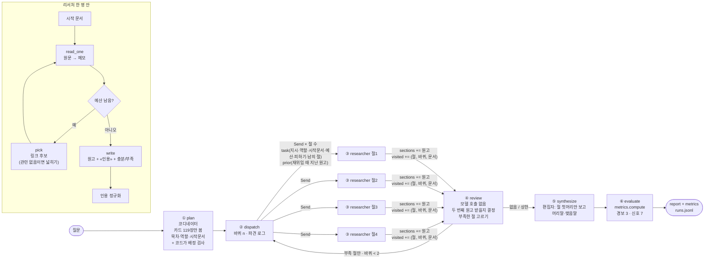

# REPORT — 교육법 딥리서처

## 1. 주제와 코퍼스

**주제 — 가르치는 사람을 위한 학습법.** 학원을 운영하면서 모두의연구소·대학·평생교육원에서도 가르칠 일이 있어, "청소년과 성인을 각각 어떻게 가르쳐야 하고 AI는 수업에 어떻게 써야 하나"를 현장에서 바로 쓸 수 있는 근거와 함께 알고 싶었다. 한 문서로 답이 나오지 않는 질문이다 — 발달 이론, 성인 학습 이론, 공부법 실험, 수업 설계, AI 튜터 연구가 서로 다른 문서에 흩어져 있다.

| 묶음 | 건수 | 글자 | 토큰(실측) | 왜 넣었나 |
|---|---|---|---|---|
| 한국어 위키백과 | 44 | 229,166 | 219,451 | 메타인지·간격 반복·자기주도적 학습·피아제·비고츠키·평생교육·학원·사교육·수능 등 개념과 한국 맥락 |
| 영어 위키백과 | 36 | 674,883 | 135,179 | 한국어판이 없거나 너무 짧은 핵심 개념 — 안드라고지·형성평가·능동 학습·풀이 예제 효과·짝 프로그래밍·지능형 튜터링 시스템 등 |
| 논문 초록(OpenAlex) | 39 | 63,251 | 13,956 | "위키에 따르면"을 넘어 "연구에 따르면" — Rosenshine 수업 원리, Dunlosky 학습 기법, Roediger 인출 연습, Freeman 능동 학습, VanLehn 튜터링, AI 튜터 RCT, 가드레일 없는 GPT 실험 등 |
| **합계** | **119** | **967,300** | **368,586** | **Claude Haiku 4.5 창(200,000토큰)의 1.84배** |

- **창을 넘는다는 것을 숫자로**: 글자 수 어림(2자=1토큰)이 아니라 `tools/count_tokens.py`로 모델 토크나이저(count_tokens API)를 써서 문서마다 실제 토큰을 셌다(`data/token_count.json`). 한국어는 1토큰 ≈ 1.05자, 영어는 ≈ 4.9자라서 어림과 크게 다르다.
- **링크 627개** (`corpus.json`의 `links`): ① 위키 문서 안의 링크(코퍼스 안의 문서끼리만) ② 한국어↔영어는 위키백과 언어 간 링크로 같은 개념이면 이음 ③ 논문끼리 실제 인용 관계(23쌍) ④ 논문↔위키: 같은 개념 이름이 논문 제목·초록·키워드에 나오면 이음(57쌍). 나가는 링크가 0인 문서가 16건 있다(수능·포모도로 기법·Rosenshine 2012 등) — 탐색으로는 닿지 못하고 코디네이터의 배정만이 유일한 길이다.
- **한 번 모아 저장**: 위키 `tools/collect_corpus.py`(시드 목록 `seeds_ko.txt`·`seeds_en.txt`, 꼬리 절 '각주·참고 문헌' 제거) → 논문 `tools/add_papers.py`(시드 `seeds_papers.txt`, OpenAlex 응답은 `papers_raw.json`에 캐시, 고전 논문 8편은 검색이 엉뚱한 논문을 잡아 DOI로 직접 지정). 에이전트는 실행 중 인터넷을 검색하지 않는다 → 설정끼리·대조군과 같은 자료로 비교할 수 있다.

**질문 세트 10건** (`data/questions.json`, 정답표 없음 · 질문마다 "왜 나눌 만한가" 한 줄)

| id | 유형 | 질문 | 왜 나눌 만한가(요약) |
|---|---|---|---|
| Q1 | 종합 | 학원·대학·평생교육원에서 청소년과 성인을 가르칠 때 효과적인 수업 방법, AI는 어떻게? | 청소년 공부법·성인 교육·AI 활용이 다른 문서 묶음에 흩어져 있다 |
| Q2 | **한 건** | 포모도로 기법은 어떻게 하는 공부법인가? | **나눌 이유가 없다** — 이 구조가 낭비인 경우 |
| Q3 | **한 건** | ADDIE 모형은 수업을 어떤 단계로 설계하는가? | **거의 나눌 이유가 없다** — 넷이 한 문서 주변을 맴도는지 |
| Q4 | 흩어진 | 학원 시험 대비 수업: 인출·간격·교차 연습의 근거와 수업에 넣는 법 | 방법마다 근거 논문·개념 문서가 따로 있다 |
| Q5 | 흩어진 | 수업에 생성형 AI를 쓸 때 돕는 법과 해치는 법 | 돕는 쪽·해치는 쪽 연구가 다른 곳에 |
| Q6 | 한 대상 따라가기 | 간격 반복: 에빙하우스 → 학습 앱까지 | 링크를 타고 시대순으로 좇아야 한다 |
| Q7 | 한 대상 따라가기 | 근접 발달 영역 → 비계 설정 → 지능형 튜터 | 한국어 → 영어 문서 → 논문으로 언어를 건넌다 |
| Q8 | 쟁점 | 학습 양식·다중지능에 맞춰 가르치라는 주장은 맞나? 교육 신화는? | 주장과 반박이 다른 문서에 |
| Q9 | 흩어진 | 평생교육원·부트캠프에서 성인의 참여를 높이고 중도 이탈을 줄이려면? | 성인 학습 이론·온라인/MOOC 연구·수업 형태가 흩어짐 |
| Q10 | 흩어진 | 입시·사교육 환경에서 자기주도학습과 메타인지를 키우려면 학원은? | 입시 문서와 학습 이론 문서가 링크로 안 이어짐 |

## 2. 분업 설계

### 목차를 무엇으로 나누나

목차 지침(`config.json`의 `목차_지침`): **학습자 집단(청소년·성인) · 학습 방법(인출 연습·간격 학습·거꾸로 수업…) · 도구(AI 튜터·생성형 AI) · 쟁점**처럼 질문이 실제로 묻는 덩어리로 나눈다. '개요·이론·사례·시사점' 같은 형식 단위는 금지 — 형식으로 나누면 넷이 같은 문서(예: «Dunlosky 외 (2013)»)를 네 번 읽는다.

처음에는 교육 주제라서 목차를 나누기가 쉬울 줄 알았는데, 해 보니 가장 어려운 부분이었다. 교육 문서는 '누구를(청소년·성인) × 어떻게(인출·간격·거꾸로 수업…) × 무엇으로(AI 튜터·생성형 AI)'가 서로 얽혀 있어서, 학습자로 자르면 방법이 겹치고 방법으로 자르면 학습자가 겹친다.

실행 기록을 보면 코디네이터는 두 가지 방식으로 나눴다.
- **Q1(종합)**: "청소년 특성 / 성인 특성 / 공통으로 효과 있는 방법 / AI 활용" — 학습자와 도구로 나눈, 내용 단위에 가까운 목차다. 절마다 시작 문서가 달랐고(피아제 · 성인교육 · Testing effect · AI in education) 중복률이 3회 모두 0%였다.
- **Q4(학원 시험 대비 공부법)**: "개념과 연구 근거 / 학원 수업에 적용하기 / 효과적인 조건과 한계" — 겉으로는 내용 같지만 실제로는 **기능(형식)으로 나눈 목차**였다. 세 절이 모두 인출·간격·교차 세 방법을 다뤄야 해서 같은 핵심 문서(Testing effect · Spacing effect · Dunlosky · Rohrer)를 필요로 했다. 그 결과 3절(한계)은 2바퀴에서 '다른 절이 이미 읽은 문서'가 피하기 목록에 들어가 정작 필요한 문서를 못 읽고 «메타인지»로 밀려났다(6-5절에서 추적).

그래서 내가 내린 기준은 **"절마다 읽을 문서가 서로 달라지도록 나눈다"**이다. Q4라면 "인출 연습 / 간격 학습 / 교차 연습 / 세 가지를 한 수업에 묶기"처럼 방법별로 나눠야 했다 — 같은 15건을 혼자 읽은 단일 대조군이 실제로 이렇게 나눴고, 그 보고서가 더 쓸모 있었다(5절). 목차 지침에 "'개념·적용·한계'처럼 같은 문서를 다시 읽게 되는 기능별 분할 금지"를 더 분명히 넣는 것이 다음 할 일이다.

### 역할 명단 (`config.json`의 `역할명단`, 프롬프트 첫 문장이 된다)

| 역할 | 하는 일 | 왜 이 주제에 필요한가 |
|---|---|---|
| 큰그림 담당 | 윤곽과 핵심 개념·방법을 간추림 | 기본값(역할 끔일 때 모두 이 역할) |
| 근거 담당 | 연구가 무엇을 비교했고 결과가 어땠는지(대상·조건·효과) | 논문 초록에서 "효과 있다"만이 아니라 조건을 뽑게 |
| 현장 적용 담당 | 개념·연구를 학원·대학·평생교육원 수업 장면의 강사 행동으로 | 이 프로젝트의 목적(실용) |
| 학습자 담당 | 청소년·성인의 특성이 방법에 만드는 차이 | 질문이 늘 '청소년 vs 성인'을 묻는다 |
| 비교 담당 | 같은 잣대로 견줌 | 쟁점·비교 질문 |
| 한계 담당 | 통하지 않는 조건·비판·위험·오해 | AI 위험, 학습 양식 신화 등 |

### 배정·구역 규칙

1. **코디네이터는 원문을 보지 않는다.** 문서 119건마다 제목 + 앞 250자 카드(약 33,000자)만 보고 목차·역할·시작 문서를 정한다. 실제 입력은 약 18,000토큰 = 창의 9%.
2. **배정 검사는 코드가**: 시작 문서가 코퍼스에 없거나(모델이 그럴듯한 제목을 지어냄) 다른 절과 겹치면 가장 닮은 실제 문서로 바꾸고 `보정된배정`에 센다. 역할이 명단에 없으면 기본 역할.
3. **동시 파견 + 남의 구역 알리기**: 1바퀴엔 다른 절의 시작 문서를, 2바퀴부터는 다른 절이 실제로 읽은 문서까지 피하기 목록으로 보낸다. 다른 절 제목도 함께 보내 "다른 절이 다룰 내용은 쓰지 마라".
4. **리서처의 도구 두 개**: `read_one`(문서 통째로 읽고 지시에 쓸 재료만 6문장 이내 메모 — 원문은 이 함수 밖으로 안 나감) · `pick`(다음에 읽을 문서를 후보 중 하나). 후보는 읽은 문서의 링크 → 막히면 코퍼스 전체.
5. **넓히기(이 프로젝트에서 더한 장치)**: 직전 메모가 '관련 없음'이면 후보를 링크 바깥(코퍼스 전체)까지 넓힌다. 시뮬레이터 첫 실행에서 리서처가 이론 문서 동네(피아제→비고츠키→근접 발달 영역)를 못 벗어나 절 하나가 빈 사고에서 나왔다.
6. **자기 신고 → 부족한 절만 재위임**, 바퀴 상한 2. 재위임 지시에는 지난번에 읽은 문서와 부족 사유를 붙인다.
7. **두 번째 원고 규칙 — 무조건 덮어쓰지 않는다** (`graph.better`): 새 원고에 허위 인용이 없고, 실제로 읽은 문서 인용 수가 줄지 않을 때만 받는다. 덮어쓰기만 하면 인용을 빠뜨린 두 번째 원고가 멀쩡한 첫 원고를 지운다. 실제로 Q1 실행에서 2절의 2바퀴 원고가 허위 인용 1곳으로 **버려지고** 1바퀴 원고가 최종본에 실렸다(`output/runs.jsonl`의 `decisions`).
8. **인용 정규화**: 리서처가 실제로 읽은 논문을 «저자 (연도)» 없이 줄여 인용하면 원래 제목으로 바로잡는다. 읽지 않은 문서는 건드리지 않는다(허위 인용으로 잡혀야 하므로). 단일 대조군에도 똑같이 적용.
9. **편집자는 절 첫머리 90자만** 보고 머리말·맺음말만 쓴다. 본문은 고치지 않는다.

### 격리 — 숫자로

`LLM` 래퍼가 호출마다 '누가(코디네이터 / 절 n / 단일)' 보냈는지와 입력 토큰을 따로 센다(`metrics`의 `토큰`, `코디네이터창`, `리서처최대창`). 예: Q1 기본 실행 — 코디네이터 약 18,400토큰(창의 9.2%, 카드와 절 첫머리만), 리서처 한 명 최대 약 21,000토큰(10.6%). 같은 양을 혼자 읽은 단일 대조군은 약 80,000토큰(39.8%)을 한 창에 쌓았다.

## 3. 지표 — 정답표도 판정 모델도 쓰지 않는다 (`metrics.py`)

| 지표 | 종류 | 한 줄 | 나쁘면 볼 장치 |
|---|---|---|---|
| 허위인용 | 🚨 경보 | 아무도 읽지 않은 문서를 인용한 수 | ③ 집필 프롬프트 |
| 코퍼스밖인용 | 🚨 경보 | 코퍼스에 없는 제목을 인용한 수 | ③ 집필 · 제목 표기(인용 정규화) |
| 빈절 | 🚨 경보 | 실린 절 중 실제 읽은 문서 인용이 0인 절 | ① 배정 · ③ 넓히기 · ④ 재위임 |
| 근거율 | 신호 | 문장 중 실제 문서 «인용»이 붙은 문장 비율 | ③ 절예산 · 메모 품질 |
| 중복률 | 신호 | 읽기 중 이미 다른 절이 읽은 문서를 또 읽은 몫 | ② 구역 · ① 배정 |
| 인용편중 | 신호 | 가장 많이 인용된 문서 한 건의 몫 | ① 배정 · ② 구역 |
| 읽고안쓴 | 신호 | 읽었지만 보고서에 안 나온 문서 수 | ① 배정 · ③ 고르기 · 넓히기 |
| 예산소진율 | 신호 | 읽은 횟수 ÷ (절수 × 절예산) — 대조군이 같은 양을 읽었는지 | ③ 고르기(일찍 그만둠) |
| 코디네이터창 / 리서처최대창 | 신호 | 본 입력 토큰 ÷ 창 | 격리 설계 |

- **문장 자르기 규칙을 고정했다**: 리서처는 «인용»을 마침표 뒤에 붙인다. 그대로 자르면 인용이 다음 문장 몫이 되어 근거율이 실제보다 낮게 나온다(수업에서 67.4% vs 85.4%). 마침표 뒤 «인용»을 앞 문장으로 옮긴 뒤 자르는 규칙을 처음부터 고정해 두고 바꾸지 않았다 — "지표가 좋아진 줄 알았는데 자르는 규칙이 바뀐 것"인 사고를 막으려고.
- **버린 지표**: 인용 문서에 문장의 낱말이 있는지(어휘 겹침) — 영어 문서를 한국어로 인용해서 겹침이 원래 낮고, 기준값을 정할 근거가 없다.
- **오귀속은 숫자가 못 잡는다**: 읽은 문서를 엉뚱한 문장에 붙인 것은 사람만 잡는다 → 데모의 '인용 대조' 화면.

## 4. 파이프라인 구조도

**상태(State)**: `question` · `plan`(목차·배치·바퀴·보정) · `sections`(리듀서 `operator.add` — 재위임되면 같은 절 원고가 하나 더 붙음) · `visited`(add) · `decisions`(add, 두 번째 원고 받음/버림) · `report` · `metrics` · `log`(add) · `task`/`prior`(Send로 리서처 하나에게만). 점검과 종합은 같은 규칙(`accepted()`)으로 절마다 원고 하나를 고른다.

## 5. 성능 검증 — 결과물을 직접 비교하기

**실험 규모**: 질문 3개(Q1 종합 · Q4 흩어진 · Q9 흩어진) × 3회 × 7설정(기본 · 장치 끔 5종 · 단일 대조군) = 63회 계획, **60회 완료**(Q9 단일 대조군 3회는 API 크레딧 소진으로 못 돌림). 결과: `output/ablation.json`, 데모 '실험 결과' 페이지. 모델 Claude Haiku 4.5, 실행 1회 ≈ $0.15.

**스위치가 정말 꺼졌나 — 60회 모두 '경로 확인' 통과**: 배정 끔 → 시작 문서 전부 빈칸 · 구역 끔 → 보낸 피하기 0건 · 역할 끔 → 역할 전부 '큰그림 담당' · 재위임 끔 → 최대 1바퀴 · 넓히기 끔 → 넓힌 횟수 0 · 단일 → 예산 소진 100%.

**대조군이 공정한가**: 같은 모델 · 같은 자료 · 같은 도구(읽기·고르기·넓히기) · 같은 카드 목록. 읽기 예산은 같은 질문·같은 시행의 '기본'이 실제로 읽은 횟수와 똑같이 줬고(예: Q1 t1 = 21건), 중간에 그만두려 하면 다음 후보를 강제로 읽혀 **예산을 100% 다 썼다**(강제 횟수는 기록에 남김). 인용 정규화도 똑같이 적용.

**결과 — 시행 3회 평균 [최소~최대]** (지표는 순위표가 아니라 명백한 실패를 거르고 '어느 장치를 볼지' 가리키는 데만 쓴다)

| 설정 | Q1 근거율 | Q4 근거율 | Q9 근거율 | Q1 중복률 | **Q4 중복률** | Q9 중복률 | Q1 읽고안씀 | Q4 읽고안씀 | Q9 인용편중 | 경보(3질문 합) |
|---|---|---|---|---|---|---|---|---|---|---|
| 기본 | 55.8 [55.0~57.1] | 57.3 [53.6~59.4] | 62.7 [59.5~64.7] | 0.0 | 11.6 [0~23.1] | 3.1 [0~4.8] | 5.3 | 3.3 | 18.7 | 0 |
| 배정 끔 | 68.9 [67.6~70.6] | 63.8 [55.2~71.9] | 58.2 [54.1~61.1] | 1.6 | 10.6 | 7.2 [0~17.4] | **9.0** | **6.0** | 17.7 | 1 |
| 구역 끔 | 53.4 [44.7~70.6] | 64.0 [62.1~65.7] | 55.9 [55.3~56.2] | 4.6 [0~9.1] | **44.2 [35.0~50.0]** | 1.8 | 4.7 | 3.0 | 21.4 | 1 |
| 역할 끔 | **47.7 [46.7~48.8]** | 56.7 [48.4~61.8] | 63.8 [55.6~75.0] | 2.8 | 6.6 | 0.0 | 5.7 | 4.7 | 18.6 | 2 |
| 재위임 끔 | 47.4 [37.8~63.9] | 58.5 [50.0~64.1] | 54.4 [51.9~57.1] | 0.0 | 10.4 | 0.0 | 0.7 | 0.3 | **30.2 [25.0~35.7]** | 1 |
| 넓히기 끔 | **38.1 [32.6~44.7]** | 69.8 [67.9~71.4] | 50.5 [28.6~65.7] | 2.2 | 10.7 | 2.2 | 5.3 | 5.0 | 20.4 | 1 |
| 단일 대조군 | 75.7 [68.3~80.0] | 76.7 [73.9~80.6] | (못 돌림) | 0.0 | 0.0 | — | 6.3 | 5.0 | — | 3 |

예산 소진율(읽은 횟수 ÷ 절수×절예산): 기본 Q1 172% · Q4 125% · Q9 156% (재위임으로 더 읽음) / 재위임 끔 Q1 100% · Q4 **72%** · Q9 **72%** (리서처가 예산을 다 쓰기 전에 그만둔 절이 있고, 다시 보낼 길도 없음). 보고서 길이: 기본 3,900~4,500자, 단일 5,000~8,100자.

**읽는 법 — 신호가 가리키는 장치** (범위가 겹치면 방향을 단정하지 않는다)
- **구역(피하기 목록)이 값을 했다 — 가장 뚜렷한 신호.** Q4에서 끄면 중복률이 11.6%에서 44.2%로, 세 번 모두(35~50%) 기본의 최댓값(23.1%)보다 높다. 인출·간격·교차 연습 문서들이 서로 링크로 촘촘히 이어져 있어서, 피하라고 알려 주지 않으면 리서처들이 «Testing effect»·«Spacing effect»·«Dunlosky 외 (2013)»로 몰려든다. 링크가 듬성한 Q1·Q9에서는 차이가 작다 — 구역 장치의 값어치는 자료의 링크 밀도에 달려 있다.
- **재위임은 '편중'과 '일찍 멈춤'을 막는다.** 끄면 Q9 인용 편중이 18.7%에서 30.2%로(범위 겹치지 않음) — 한두 문서에 기대 쓴 절이 그대로 실린다. Q4·Q9에서 예산 소진이 72%로 떨어진 것도, 일찍 그만둔 절을 다시 보낼 길이 없어서다. 대신 재위임은 읽기를 1.3~1.7배로 늘린다 = 비용.
- **넓히기는 질문에 따라 방향이 갈린다.** Q1에서 끄면 근거율 55.8% → 38.1%(범위 겹치지 않음) — 시뮬레이터 첫 실행에서 본 '이론 문서 동네에 갇히는' 일이 다시 일어난다. 그런데 Q4에서는 끈 쪽이 더 높다(69.8%). Q4는 관련 문서가 한 동네에 모여 있어 넓히면 오히려 바깥의 덜 맞는 문서를 집는 것으로 보인다. **한 질문만 돌렸다면 정반대 결론을 냈을 것이다.**
- **배정은 '읽고 안 쓴 문서'를 줄인다.** 끄면 Q1 5.3 → 9.0, Q4 3.3 → 6.0. 리서처가 카드 없이 제목만 보고 첫 문서를 고르다 보니 엉뚱한 문서를 읽고 버린다. 그런데 Q1 근거율은 끈 쪽이 높다(68.9%) — 보고서가 짧아져(3,890자) 적은 문서에 기대 쓴 결과다. **근거율만 보면 '배정 끔'이 1등이라 잘못 결론 낼 수 있는 사례.**
- **역할은 Q1에서만 신호가 있다**(55.8 → 47.7%, 범위 겹치지 않음). Q4·Q9는 범위가 겹쳐 결론을 내지 않는다.
- **단일 대조군이 숫자로는 가장 좋아 보인다**(근거율 75~77%, 중복 0%). 하지만 중복 0%는 혼자 읽으니 당연하고(같은 문서를 두 번 읽지 않음), 근거율이 높은 건 메모 15~21장을 한 번에 넣고 쓴 덕분이다 — 대신 한 창에 원문 요약을 다 쌓아 리서처 최대창이 40%대(다중은 10~20%)이고, 보고서가 길어 문장마다 «인용»을 달기 쉽다. **이 숫자로 '단일이 낫다'고 결론 내리지 않는다** — 질문에 맞게 답했는지, 앞 절에 근거가 몰렸는지는 아래 나란히 읽기로 판단한다. 단일은 Q1에서 경보도 있었다(3회 중 코퍼스 밖 인용 1·2건).
- **경보 8건을 하나씩 열어 봤다**: 허위 인용(안 읽은 문서 인용)은 60회 내내 **0건**. 8건 중 7건이 '코퍼스 밖 인용' — 실제로 읽은 문서인데 제목을 틀리게 쓴 경우다: 두 제목을 한 «» 안에 붙임(«Experiential learning, Andragogy»), 제목을 빼고 저자·연도만(«Dunlosky 외 (2013)»), 한영 섞어 바꿔 씀(«Formative평가»), 개념을 제목처럼(«비고츠키의 발달심리학 이론»). 인용 정규화는 '줄여 쓴 제목'만 고치도록 좁게 만들어서 이런 경우는 일부러 그대로 경보로 남겼다. 나머지 1건은 Q9 넓히기 끔의 빈 절(«중도 이탈 예방…») — 넓히기를 끄자 근거를 못 찾은 절이 그대로 실렸다.

### 나란히 읽기 — Q4 "학원 시험 대비 공부법" (`abl-Q4-t1-기본` vs `abl-Q4-t1-단일`)

두 보고서 모두 같은 15건을 읽었다(단일 대조군에게 기본과 똑같은 읽기 예산을 주고 끝까지 쓰게 했다). 데모의 '나란히 비교'에 놓고 처음부터 끝까지 읽었다.

**어느 쪽이 나은가 — 이 질문에서는 단일 대조군이 낫다.**

학원 강사인 내가 내일 수업에 바로 쓸 수 있는 내용이 단일 쪽에 훨씬 많았다. 단일 보고서는 "인출 연습 / 간격 학습 / 교차 연습 / 세 가지를 학원 수업에 묶는 법"으로 나뉘어 있고, 마지막 절에 "정기적인 저부담 퀴즈", "사전 시험 → 학습 → 사후 시험(피드백 포함)", "지난 주제 문제를 숙제에 섞기", "라이트너 상자 1일·3일·5일 복습", "객관식보다 단답형·서술형" 같은 구체적인 방법이 있다. 근거 숫자도 정확했다 — 7학년 126명, 3개월, 효과 크기 0.42·0.79(Rohrer 2014 초록과 일치).

기본(다중) 보고서는 첫 절 하나에 세 방법을 모두 몰아넣었고, 적용 절(2절)은 "시험 직후 문제를 풀게 하고 일주일 뒤 다시"처럼 짧았으며, 한계 절(3절)은 메타인지 이야기로 흘러가다 "통합적 실증 데이터는 제시된 자료에 부족하다"로 끝났다. 보고서 길이도 3,201자로 단일(4,403자)보다 짧다.

**왜 — 내 생각**: 이 질문은 이미 '세 방법'이라는 축이 정해져 있는데, 코디네이터가 그 축이 아니라 '개념 / 적용 / 한계'라는 기능으로 목차를 짰다. 그러자 세 리서처가 같은 핵심 문서를 원했고, 피하기 목록 때문에 서로의 문서를 못 읽었다. 분업이 오히려 정보를 쪼개 놓은 셈이다. 반대로 단일 에이전트는 메모 15장을 한 번에 다 보고 방법별로 다시 묶을 수 있었다. 이 질문의 자료 크기(15건, 메모 합계 약 5,500자)는 한 창에 충분히 들어가서, 나눠 읽는 이점보다 쪼개서 잃는 것이 컸다. **분업은 '자료가 창에 안 들어갈 때'와 '절마다 다른 문서를 읽을 수 있을 때' 값을 한다**는 것을 숫자가 아니라 읽어서 알았다. (근거율도 단일 80.6% vs 기본 53.6%로 같은 방향이었지만, 숫자만으로는 '단일이 낫다'고 말하지 않았을 것이다 — Q1에서는 '배정 끔'이 근거율 1등이었지만 보고서는 기본보다 짧고(3,470~4,356자 vs 4,181~4,763자) 읽고 버린 문서가 8~10건으로 많았다.)

**마음에 안 드는 대목과 추적**: 기본 보고서 3절 「세 가지 공부법이 효과적인 조건과 한계」. 절별 추적으로 따라가 보니 — 시작 문서 «Cepeda 외 (2006)» → «Bjork 외 (2012)» → «Pashler 외 (2008)»(메모 '관련 없음') → '부족' 신고로 2바퀴 재위임 → 2바퀴 피하기 목록에 다른 절이 읽은 Testing effect · Spacing effect · Dunlosky · Rohrer · Karpicke · Roediger가 모두 들어가 → «Settles 외 (2016)» · «메타인지» · «Zimmerman (2002)»를 읽음 → "메타인지 능력은 IQ나 사전 지식 부족을 보상할 수 있다"«메타인지» 같은, 질문(학원 시험 대비)과 거리가 먼 문장이 들어갔다. 원인은 리서처가 아니라 목차(기능별 분할)와 2바퀴 구역 규칙이 부딪힌 것이다.

**인용 대조 — 원문과 직접 맞춰 본 5곳**
| 보고서 | 문장(요약) | 붙은 인용 | 원문 확인 | 판정 |
|---|---|---|---|---|
| 기본 1절 | Rohrer 수학 연구에서 문제를 섞은 학생이 공식 적용 시기 판단에서 우수 | «Spacing effect» | 이 위키 문서에 Rohrer(2006) 2부 실험 — 유형별 묶음 vs 무작위 섞기, 섞은 쪽이 훨씬 우수 — 이 실제로 있음 | ✅ 제자리 |
| 기본 1절 · 단일 2절 | 간격 학습이 271건 중 259건에서 우수 | «Spacing effect» | "outperformed … in 259 out of 271 cases" 그대로 있음 | ✅ 제자리 |
| 단일 2절 | **Cepeda 등(2006)의 메타분석에서 839개 평가를 분석한 결과** … 259건 | «Spacing effect» | '839개 평가'는 «Cepeda 외 (2006)» 초록에만 있고 Spacing effect 문서에는 없음. 두 문서 내용을 한 문장에 섞고 인용은 하나만 | ⚠️ **오귀속(일부)** |
| 단일 3절 | 7학년 126명, 3개월, 효과 크기 0.42·0.79 | «Rohrer 외 (2014)» | 초록 숫자와 정확히 일치 | ✅ 제자리 |
| 단일 4절 | 라이트너 상자 1일·3일·5일 복습 | «Leitner system» | "Box 1 once a day, Box 2 every 3 days, Box 3 every 5 days" 그대로 | ✅ 제자리 |

숫자 지표에서 두 보고서 모두 허위 인용 0이었지만, 직접 맞춰 보니 단일 쪽에 숫자가 못 잡는 오귀속이 하나 있었다. 아래 6-5의 포모도로 사례는 더 분명한 경우다.

### 이 구조를 쓰면 안 되는 경우 — Q2 "포모도로 기법은 어떻게 하는 공부법인가?" (한 건 질문)

| | 다중(기본) | 단일 대조군 |
|---|---|---|
| 목차 | 3절 — 시작 문서 «포모도로 기법» · **«간격 반복»** · **«메타인지»** | 없음 |
| 읽기 | 15회(1바퀴 9 + 재위임 6) | 15회(같은 예산, 끝까지) |
| 호출 / 입력 토큰 | 34회 / 111,347 | 31회 / 86,331 |
| 가장 많이 인용된 문서 | **«메타인지»** (20%) | «포모도로 기법» (25%) |
| 읽고 안 쓴 문서 | 6 | 11 |
| 경보 | 0 | 0 |

- 답은 «포모도로 기법» 한 건(약 1,000자)에 있다. 그런데 코디네이터는 절 수 상한(4)에 끌려 절을 셋으로 나눴고, 둘은 질문과 다른 문서(간격 반복·메타인지)에서 출발했다. 그 결과 **보고서에서 가장 많이 인용된 문서가 포모도로가 아니라 메타인지**가 됐다 — 질문에서 벗어난 내용이 보고서의 중심을 차지했다.
- 두 절이 "25분·5분 같은 구체적 시간 배분이 자료에 없다"고 '부족'을 신고해 재위임까지 돌았다. 한국어 위키 문서에 없는 정보를 찾느라 6건을 더 읽었다.
- 문서 한 건을 읽고 답하면 호출 2번(읽기·쓰기)이면 될 일에 호출 34번, 입력 11만 토큰을 썼다. **나눌 이유가 없는 질문에 이 구조를 쓰면 비용만 드는 게 아니라 답이 질문에서 멀어진다.**
- 고칠 방향: 코디네이터가 "절이 하나면 충분한 질문"을 알아보게 하기(지금 프롬프트에 '절을 적게 짜도 된다'고 했지만 지켜지지 않았다) — 예: 기획 전에 카드 목록에서 질문과 직접 맞는 문서가 한 건뿐이면 절 1개로 강제.

두 보고서를 나란히 읽어 보니 **둘 다 첫 문단에서 답은 다 했다** — "1980년대 후반 프란체스코 시릴로, 타이머로 25분 집중 + 5분 휴식, 토마토 모양 타이머에서 이름이 옴". 이게 «포모도로 기법» 원문(285자)의 전부다. 나머지는 둘 다 메타인지·간격 학습·자기조절학습 이야기로 분량을 채웠다. 같은 예산(15건)을 끝까지 쓰게 한 탓에 단일 대조군도 덜 맞는 문서를 읽고 덧붙였다. 그래도 단일 쪽이 '포모도로 → 메타인지 → 자기조절' 순으로 한 줄기로 이어져 덜 산만했고, 다중 쪽은 3절이 메타인지에서 출발해 질문에서 가장 멀어졌다. 결론: **이런 질문은 나누지도, 많이 읽지도 말고 문서 한 건을 읽고 답하는 것이 맞다.** 그리고 다중 쪽 1절에는 원문에 없는 연결을 지어낸 문장이 있었다(6-5).

## 6. 실패 분석 — 마음에 안 드는 대목을 어느 절·어느 자료까지 추적했나

### 6-1. 시뮬레이터 첫 실행: 1절이 182자 · 인용 0곳 (`learning-travel-sim`, pipeline.py 원본 구조)
절 1 «청소년 학습자의 발달 특성과 효과적 수업 방법»
1. **기획**: 지시는 "검증된 수업 방법(능동 학습·또래 지도·피드백)의 효과"인데 시작 문서는 이론 문서 «피아제의 인지 발달론» — 지시와 배정이 어긋남.
2. **읽기**: 피아제 → 레프 비고츠키 → 근접 발달 영역, 메모 셋 다 "관련 없음".
3. **고르기**: 후보가 읽은 문서의 링크뿐이라 이론 문서 동네를 못 벗어남. «Active learning»·Freeman(2014)은 후보에 없었다.
4. **집필**: 리서처는 지어내지 않고 "자료가 없다"고 썼다(정직). 그러나 원본 구조엔 점검·재위임이 없어 다시 보낼 길이 없었다.
→ 고친 것: 기획 프롬프트에 "지시는 시작 문서에서 찾을 수 있는 것과 어긋나지 않게", 넓히기 장치, ④ 재위임.

### 6-2. 리서처가 1건만 읽고 멈춤 — 원인은 모델이 아니라 내 코드
후보 목록을 `A | B | C`로 이어 보여 줬더니(논문 제목에 쉼표가 많아서) 모델이 `"근접 발달 영역 | 레프 비고츠키"`처럼 두 제목을 붙여 답했고, 코드가 이를 없는 제목으로 보고 읽기를 멈췄다. 한 줄에 하나씩 보여 주고, 조금 어긋난 답은 후보 안에서 바로잡고 횟수를 세게 고쳤다(`고르기보정`·`고르기실패`). 기록: `output/runs.jsonl`의 `버그-고르기구분자`.

### 6-3. 넓히기 장치가 한 번도 안 켜짐 — 판정 문자열이 빗나감
메모가 `# 문서 검토 결과 … **관련 없음**`처럼 머리말을 붙여 와서 "관련 없음으로 시작하나" 검사가 실패 → 넓힌 횟수 0, 관련 없음 메모가 원고 재료에 섞임. 앞 네 줄 중 '관련 없음'으로 시작하는 줄이 있는지로 고쳤다(본문 속 "관련 없음이 아니라"는 걸리지 않게 시험). 기록: `버그-관련없음판정`.

### 6-4. 읽은 논문을 인용했는데 '코퍼스 밖 인용' + '빈 절' 경보
리서처가 «Rohrer 외 (2014) Interleaved practice improves mathematics learning» 대신 «Interleaved practice improves mathematics learning»처럼 저자·연도를 빼고 인용 → 실제로 읽은 문서인데 지표는 '코퍼스 밖'·'빈 절'로 셌다. 같은 실행에서 Roediger의 이름 "Henry L. Roediger **III**" 때문에 문서 제목이 «III 외 (2006)…»로 만들어진 수집 버그도 찾았다. 인용 정규화(읽은 문서만)와 접미사 처리를 넣고, 이미 시작한 본 실험을 멈췄다가 다시 돌렸다 — 고치기 전 결과로 결론을 내지 않으려고. 기록: `시험-Q4-t1-*`.

### 6-5. 숫자는 통과했지만 읽어 보니 틀린 문장 — 포모도로와 인지부하 (`한건-Q2-기본`, 1절)

> "이 기법의 시간 배분은 인지부하 이론에 기초하여 작동기억의 제한된 처리 용량을 고려한 설계라 할 수 있다."«인지 부하»

인용된 «인지 부하»는 리서처가 실제로 읽은 문서라서 허위 인용 0, 근거율에도 '근거 붙은 문장'으로 세어졌다. 그런데 원문을 열어 보니 «포모도로 기법»(285자)에는 인지부하 이야기가 없고, «인지 부하»에는 포모도로도 25분도 나오지 않는다. 리서처가 두 문서를 각각 읽고 **둘 사이의 연결을 스스로 지어낸** 것이다. 그럴듯해서 학원 설명회 자료에 그대로 옮겼다면 틀린 말을 퍼뜨렸을 것이다. 절별 추적으로 보면 이 절은 1바퀴에 '부족(25분·5분의 근거가 없다)'을 신고했고, 재위임된 2바퀴에서 근거를 찾으려다 이 문장이 생겼다(1바퀴 원고에는 없다). 더 아픈 점은, 내가 만든 '두 번째 원고 규칙'이 이 원고를 **받아들였다**는 것이다 — 유효 인용이 6에서 7로 늘었으니까. 인용 수만 보는 규칙은 지어낸 연결을 걸러 내지 못한다. **재위임이 '근거를 더 찾아라'고 몰아붙일 때 모델이 없는 근거를 만들어 낼 수 있고, 인용 수를 기준으로 원고를 고르면 그 원고가 오히려 이긴다**는 것을 배웠다.

### 돌아보며 — 실패에서 배운 것

6-2~6-4는 모두 "에이전트가 못했다"가 아니라 **"내가 만든 측정이 엉뚱한 것을 재고 있었다"**였다. 수업에서 경고한 세 가지 사고와 견주면:
- *"지표가 좋아진 줄 알았는데 문장 분리 규칙이 바뀐 것"* — 나는 반대 방향으로 겪었다. 제목 표기(곡선 따옴표, 저자 III, 줄여 쓴 논문 제목) 하나 때문에 멀쩡한 절이 '빈 절'·'코퍼스 밖 인용'으로 세어졌다. 그래서 규칙을 처음에 고정하고, 규칙을 고친 뒤에는 이미 돌던 실험을 멈추고 다시 돌렸다.
- *"스위치를 껐다고 로그만 찍고 코드 경로는 그대로"* — 넓히기 장치가 정확히 그랬다. 켜져 있다고 믿었는데 판정 문자열이 빗나가 한 번도 작동하지 않았다. 그 뒤로 모든 실행에 '경로 확인'(넓힌 횟수, 보낸 피하기 건수 등)을 남기게 했고, 60회 모두 통과했다.
- *"한 번 돌린 결과로 방향을 단정"* — 넓히기 장치가 Q1에서는 근거율을 크게 올렸는데 Q4에서는 오히려 내렸다. 한 질문 한 번만 봤다면 정반대 결론을 냈을 것이다.

그리고 6-5처럼 **모든 숫자를 통과한 문장도 틀릴 수 있었다.** 지표는 명백한 실패(허위 인용, 빈 절)를 거르는 데까지만 쓰고, 마지막 판단은 원문을 열어 맞춰 보는 사람이 해야 한다.

## 7. 데모 설계 (`app.py`)

- **숫자보다 '누가 무엇을 읽고 무엇을 썼나'**: '기록 보기 → 절별 추적'에서 절마다 바퀴별로 시작 문서 · 피하기 목록 · 읽은 문서(종류·원문 n자 → 메모 m자, 관련 없음 표시) · 넓히기 · 올린 원고 · 자기 신고 · 두 번째 원고를 받았나/버렸나와 이유 · 최종본에 실렸나를 한 화면에.
- **인용 색**: 실제로 읽은 문서 인용은 파란 배경, 안 읽은 문서·없는 제목은 빨간 배경 — 경보가 본문 위에서 바로 보인다.
- **인용 대조**: 인용 문서 하나를 고르면 그 문서를 인용한 문장들 ↔ 리서처 메모 ↔ 원문(핵심어 검색)을 나란히 — 숫자가 못 잡는 오귀속을 사람이 잡는 도구.
- **나란히 비교**: 같은 질문의 두 실행을 지표 표와 함께 좌우로.
- **실험 결과**: 시행별 점 + 평균·최소·최대. 한 번의 결과로 단정하지 않게 범위를 먼저 보여 준다. 경로 확인 실패가 있으면 맨 위에 경고.
- **🌏 여행 시뮬레이터**: 같은 실행 기록을 3D 세계여행으로 다시 그린다. 코디네이터는 북극의 등대 본사, 리서처는 색깔 종이비행기를 탄 여행자, 문서는 섬 도시(높이 = 글자 수, 📄 돔 = 논문), 링크는 항공 노선, 원고는 본사로 날아가는 엽서다. "원문은 현지에 남고 엽서만 올라간다"는 격리를 눈으로 보이게 하려고 골랐다. 2바퀴 재위임(🔁)과 두 번째 원고 받음 ✅ / 버림 ✋도 장면으로 나온다. 아래 디버거(⏮ ◀ ▶ ▶| ⏭, 단계·여행자별 중단점, ← → Space F10 F5)로 한 단계씩 넘기며 '누가 어디서 무엇을 읽었나'를 따라간다. 시뮬레이터는 모델을 부르지 않고 `runs.jsonl`에서 재구성하므로 원래 시각과 '고르기' 후보 목록은 없다(기록하지 않았음 — 화면에 그렇게 적었다).
- 화면 캡처: `docs/` (demo-simulator*.png · demo-report.png · demo-sections.png · demo-corpus.png)

## 8. 프로젝트 회고

**왜 이 주제였나.** 학원을 운영하면서 "어떻게 가르쳐야 오래 남는가"를 늘 고민하는데, 정작 근거는 강사들의 경험담이나 유튜브 요약에 기대고 있었다. 수업에서 배운 딥리서처 구조로 위키백과와 논문을 직접 읽혀 보면, 내가 설명회나 강사 연수에서 쓸 수 있는 '출처가 붙은' 정리를 얻을 수 있지 않을까 해서 골랐다.

**가장 공들인 부분.**
- **자료**: 한국어 위키만으로는 성인 학습·AI 튜터 쪽이 비어 있어서 영어 위키와 논문 초록 39편을 더했다. 학원·부트캠프·평생교육원에서 바로 쓰는 연구(Rosenshine 수업 원리, 형성평가, 인출·간격·교차 연습, 짝 프로그래밍, AI 튜터 실험)를 고르는 데 시간을 가장 많이 썼다. 창을 넘는지는 글자 수 어림이 아니라 토큰을 실제로 세어 확인했다(1.84배).
- **두 번째 원고 규칙**: 재위임된 원고가 무조건 덮어쓰지 않게 했다. 실제로 허위 인용이 섞인 두 번째 원고가 버려지고 멀쩡한 첫 원고가 남는 장면을 여러 번 봤다.
- **공정한 대조군**: 단일 에이전트에게 같은 모델·자료·도구·읽기 예산을 주고 끝까지 쓰게 했다. 그랬더니 Q4에서는 단일이 더 나은 보고서를 냈다. 내 구조가 지는 결과였지만, 그래서 '분업이 언제 값을 하는가'를 제대로 알게 됐다.
- **보이게 만들기**: 절별 추적, 인용 대조, 그리고 3D 여행 시뮬레이터. 숫자만 보여 주는 화면으로는 6-5 같은 문제를 찾을 수 없었을 것이다.

**가장 크게 배운 것.** 이 프로젝트에서 나온 문제 대부분은 에러 메시지 없이 '숫자만 조금 이상한' 조용한 실패였다. 실행마다 절·바퀴·문서·메모·원고를 다 남겨 둔 덕분에 끝까지 따라갈 수 있었다. 그리고 목차가 곧 분업이라는 말을 Q4에서 실감했다 — 기능으로 나눈 목차가 리서처들을 같은 문서로 몰아 서로를 굶겼다.

**보완하고 싶은 것.**
1. **목차 기준**: '개념·적용·한계' 같은 기능별 분할을 막고, 질문에 이미 축(세 방법, 두 학습자 집단)이 있으면 그 축으로 나누게 하기. 질문과 직접 맞는 문서가 한 건뿐이면 절 1개로(Q2).
2. **재위임의 부작용**: '부족' 신고가 너무 잦다(Haiku는 거의 모든 절이 부족을 냄). 재위임 지시가 근거를 지어내게 몰아붙이지 않도록, "자료에 없으면 없다고 쓰고 멈춰라"를 더 분명히.
3. **자료**: 논문은 초록뿐이라 '현장 적용' 절이 얇다 → 오픈 액세스 본문, 국내 교육 연구(KCI) 추가.
4. **오귀속 세기**: 이번에는 몇 개만 손으로 맞춰 봤다. 보고서마다 인용 10개를 무작위로 뽑아 사람이 판정하는 절차를 만들어, 설정끼리 오귀속 비율도 견주고 싶다.
5. 실제로 우리 학원 강사 연수에 이 보고서를 써 보고, 강사들이 "이건 바로 쓸 수 있다"고 고른 대목이 어떤 설정에서 나왔는지 보는 것 — 정답표 대신 현장의 판정.
